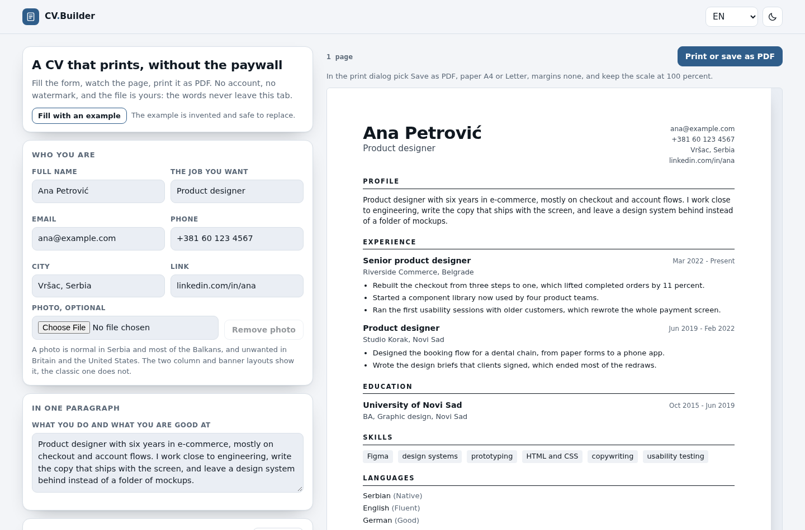

# CV Builder

**A CV that prints, without the paywall.**

[](https://tekideki.github.io/CV-Builder/)
[](LICENSE)



Fill the form on the left, watch the page on the right, print it as PDF. The download is the print dialog itself: no account, no watermark, no card, nothing to unlock.

The file is real text, not a picture of text, so the machine that sorts applications can read it.

## What it does

- **Three layouts.** Classic (one column, safest for robots), two columns, and a banner across the top.
- **A4 or Letter.** The `@page` rule follows the choice, so the printed page is exactly that size with no white border.
- **Real text.** Headings, dates and bullet points are HTML, not an image. Nothing is flattened on the way to the PDF.
- **Optional photo.** Downscaled to 420 pixels in the browser before it is stored, with a plain note that a photo is normal in the Balkans and unwanted in Britain and the United States.
- **Four interface languages.** English, Romanian, Serbian Latin and Serbian Cyrillic, remembered between visits.
- **The CV speaks four languages too.** Section headings (Profile, Experience, Present, Native, Fluent) follow a separate choice, so the document can be in one language while the editor stays in another.
- **Autosave, export, import.** Everything typed is kept in this browser as you type. A copy can be exported as JSON and opened on another computer.
- **Compact and offline.** One HTML file holds the styles, the model and all four locales, and it opens again with the network off.

## How to use it

1. Type your name and the job you want.
2. Add jobs, schools, skills, languages and certificates; each list takes one line per bullet.
3. Pick the layout, the paper, the typeface and the accent colour.
4. Press **Print or save as PDF**.
5. In the print dialog choose **Save as PDF**, paper **A4** or **Letter**, margins **None**, scale **100 percent**, and turn the browser headers and footers off.

The page count under the toolbar tells you when the CV spills onto a second page.

## Why it is built this way

**The paywall is the point.** The category this tool answers has one loud complaint: build the CV for free, then find the PDF behind a card. Here the print button is the whole product.

**No network at all.** One HTML file, no external request. The browser test fails if any request leaves the page.

**Text, not pixels.** The classic layout is one column of real headings and real paragraphs. That is the version to send when a company runs the CV through a parser.

**Deterministic build.** `python3 build.py` inlines the styles, the model and the three authored locales into `index.html`, and transliterates Serbian Cyrillic so it cannot drift from the Latin version. No timestamps, no machine paths, no em dash, no byte order mark; the build refuses all of them.

## Tests

```bash
node tests/logic_test.cjs          # model: dates, bullets, storage shape, locales
python3 tests/ui_test.py           # Chromium: load, edit, reload, print media, offline
```

The browser test starts its own server, checks that no request goes anywhere but that server, and fails on any console error.

## Development

```bash
python3 build.py                   # writes index.html from src/
python3 -m http.server 8000        # then open http://localhost:8000
```

Sources live in `src/`: `model.js` (data and formatting), `app.js` (page), `styles.css`, `template.html`, `i18n/locales.json` (interface, en, ro, sr-latn), `i18n/doc.json` (CV headings, en, ro, sr-latn).

## Licence

Apache 2.0. See `LICENSE`. Every tool here is free and stays free.
